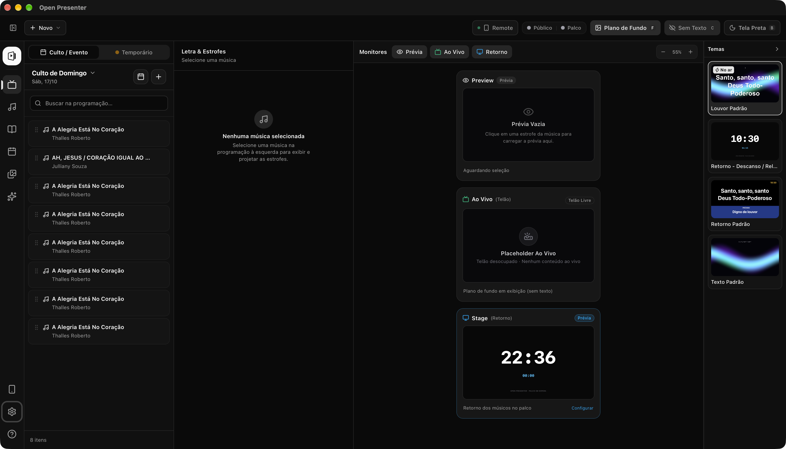
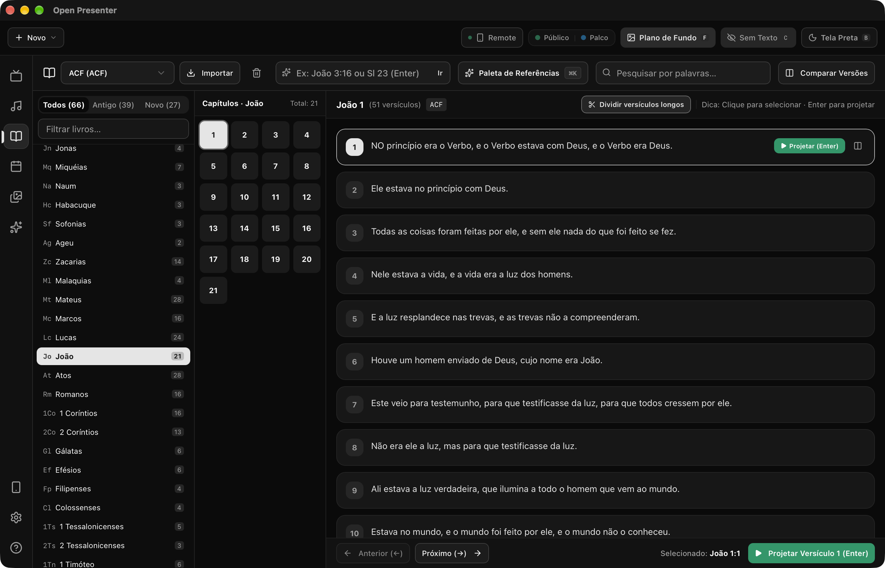
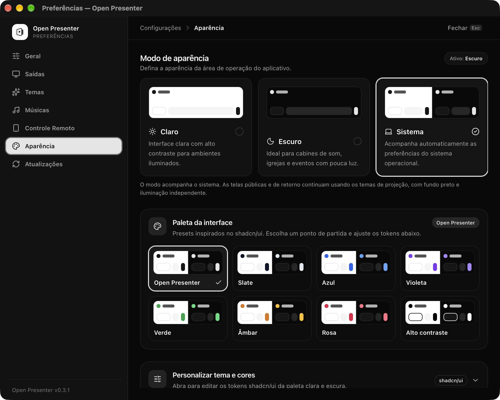
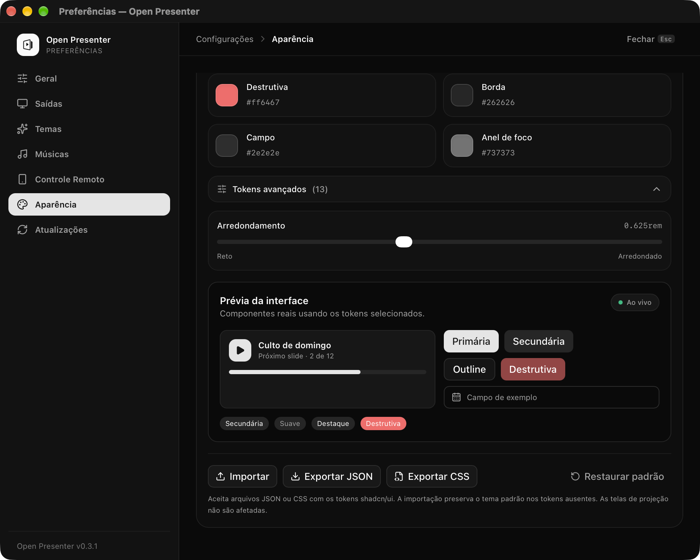
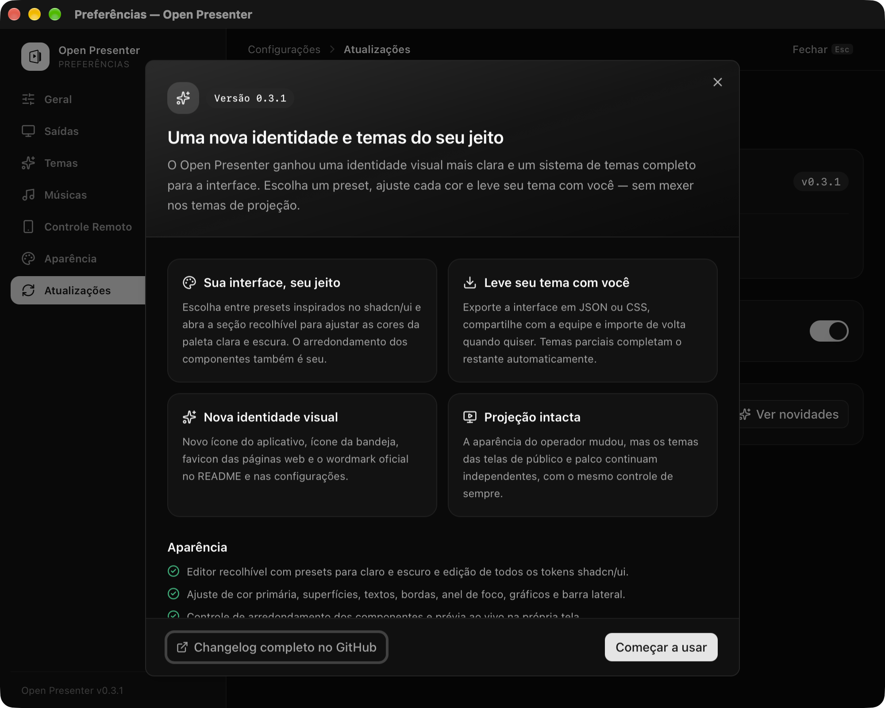
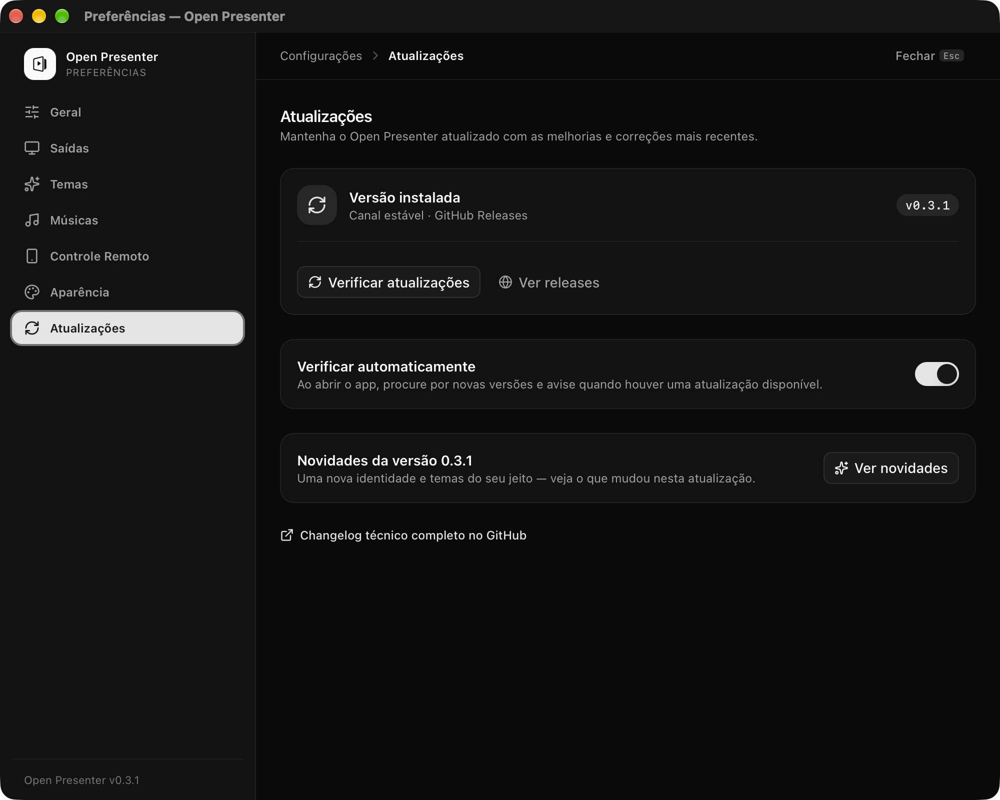

<p align="center">
  <picture>
    <source media="(prefers-color-scheme: dark)" srcset="docs/brand/open-presenter-wordmark-dark.svg" />
    
  </picture>
</p>

<p align="center">
  Software desktop open source para apresentação em igrejas e eventos.<br />
  Setlists, Bíblia, temas por momento, projeção multi-tela e controle remoto — tudo offline.
</p>

<p align="center">
  <a href="https://github.com/open-mission/open-presenter/releases/latest">
    
  </a>
  <a href="https://github.com/open-mission/open-presenter/blob/main/LICENSE">
    
  </a>
  
  
  
</p>

<p align="center">
  
</p>

## Por que Open Presenter?

O Open Presenter foi feito para quem opera projeção em igrejas e eventos: a
programação do culto, as letras, a Bíblia e as saídas de tela ficam no mesmo
lugar, com uma interface pensada para uso ao vivo.

- **Leve e offline.** Aplicativo desktop com banco local; não depende de
  internet durante o culto.
- **Multi-tela de verdade.** Público, palco e transmissão com saídas nativas,
  web ou ambas.
- **Fluxo pensado para o operador.** Atalhos, blackout, plano de fundo,
  cronômetro, prévia do próximo slide e tema por momento do culto.
- **Aberto de verdade.** Código-fonte público, licença MIT e releases
  assinadas para atualização segura.

## Download

Baixe a versão mais recente em
[**github.com/open-mission/open-presenter/releases**](https://github.com/open-mission/open-presenter/releases/latest).

| Plataforma | Arquivo recomendado | Observações |
| --- | --- | --- |
| Windows 10/11 | `.exe` (instalador) ou `.msi` | Atualizações automáticas pelo app |
| macOS (Apple Silicon) | `.dmg` | Requer macOS 12 ou superior |
| macOS (Intel) | `.dmg` | Requer macOS 12 ou superior |
| Linux | `.AppImage` | Recomendado para a maioria das distribuições |

> O Linux precisa das bibliotecas de WebView do sistema (`webkit2gtk-4.1`). Em
> distribuições baseadas em Debian/Ubuntu:
> `sudo apt install libwebkit2gtk-4.1-0`.

## Principais recursos

### Culto e programação

- Agenda de eventos e setlists com ordem de músicas, Bíblia, avisos e mídia.
- Modo temporário para cultos avulsos.
- Atalhos de teclado para avançar, voltar, projetar, limpar texto e blackout.
- Cronômetro de palco e tela de descanso para os músicos.

### Músicas e letras

- Cadastro de músicas com estrofes, refrões, pontes e grupos.
- Importação do Holyrics.
- Busca de letras na internet e vínculo automático de seções.
- Quebra de texto, auto-ajuste de fonte e prévia do próximo trecho.

### Bíblia

- Importação de versões/traduções para uso offline.
- Busca por livro, capítulo, versículo ou palavra.
- Comparação entre traduções.
- Envio de versículos para o público e para o palco.
- Aba da Bíblia no controle remoto.

<p align="center">
  
</p>

### Temas e projeção

- Temas para público e palco, com páginas por contexto do culto.
- Temas específicos para louvor, pregação, avisos e retorno do palco.
- Editor visual de camadas, mídia, texto, relógio, cronômetro e widgets.
- Importação e exportação de temas em JSON.
- Fundos com imagem, vídeo, CSS e shaders ISF.

### Aparência da interface

- Modo claro, escuro ou acompanhando o sistema operacional.
- Presets de paleta inspirados no shadcn/ui.
- Editor recolhível dos tokens shadcn/ui para as paletas clara e escura, com
  prévia ao vivo.
- Importação e exportação do tema da interface em JSON ou CSS.
- Aparência do operador independente dos temas usados nas telas de público e palco.

<p align="center">
  
</p>

<p align="center">
  
</p>

Os SVGs da identidade visual ficam em [`docs/brand`](docs/brand) e podem ser
reutilizados em materiais do projeto.

### Saídas e controle remoto

- Saída nativa em um monitor, saída web no navegador ou as duas ao mesmo tempo.
- Servidor HTTP/WebSocket embutido na porta `5050`.
- Controle remoto pelo celular, com letras, Bíblia e programação.
- Compatível com OBS Browser Source para transmissão.
- Ícone na bandeja do sistema com atalhos para abrir os links, reiniciar o
  servidor e sair do aplicativo.
- Fechamento para a bandeja configurável em **Preferências → Geral**.

<p align="center">
  
</p>

## Atualizações

O Open Presenter usa o updater oficial do Tauri:

- O app verifica novas versões ao iniciar.
- A atualização é baixada e instalada pelo próprio aplicativo.
- Todos os pacotes são assinados digitalmente; o app verifica a assinatura antes
  de instalar.
- Você também pode verificar manualmente em **Preferências → Atualizações**.

<p align="center">
  
</p>

As releases são publicadas no GitHub e o changelog técnico fica em
[`CHANGELOG.md`](CHANGELOG.md).

## Desenvolvimento

### Pré-requisitos

- Node.js **20.19+** (recomendado: versão do `.nvmrc`, atualmente 22)
- Rust **1.90+**
- Toolchain de build da plataforma:
  - macOS: Xcode Command Line Tools
  - Windows: Visual Studio Build Tools com C++ e WebView2
  - Linux: `libwebkit2gtk-4.1-dev`, `libappindicator3-dev`, `librsvg2-dev`,
    `patchelf`

### Rodando localmente

```bash
npm install
npm run tauri:dev      # app desktop completo
# ou
npm run dev            # somente o frontend web (Vite, porta 1420)
```

### Build e qualidade

```bash
npm run typecheck      # tsc -b
npm run build          # tsc -b + vite build
npm run tauri:build    # instaladores/bundles locais
cargo check -p open-presenter

# artefatos assinados para o updater (mantenedores)
npm run tauri:build -- --config src-tauri/tauri.release.conf.json
```

### Estrutura

```text
src-tauri/              # Backend Rust (commands, services, state, servidor embutido)
src/
  components/ui/        # Componentes base de UI (shadcn-like)
  core/                 # Shared kernel: config, ipc, sync, tipos, tema
  features/             # Módulos verticais (apresentação, músicas, Bíblia, temas,
                        #   saídas, remote, stage, studio, preferências)
  views/                # Composição por rota (/admin, /public, /stage, /preferences)
docs/
  releases/             # Notas amigáveis publicadas em cada release
  superpowers/          # Specs e planos de features
  screenshots/          # Imagens usadas na documentação
```

O frontend usa `HashRouter` porque o app roda sob o protocolo customizado do
Tauri e também é servido como arquivos estáticos pelo servidor embutido.

### Sincronização

A fonte da verdade do slide ao vivo é o `PresentationState` no Rust. O frontend
espelha o estado via Tauri Events no desktop e WebSocket em
`ws://<host>:5050/ws` no navegador.

## Fluxo de branches

- `main`: releases estáveis.
- `develop`: integração contínua.
- `feature/*`, `fix/*`, `release/*`, `hotfix/*`: trabalho isolado.
- Commits seguem [Conventional Commits](https://www.conventionalcommits.org/pt-br/).

Pull requests devem apontar para `develop`. A `main` recebe apenas merges de
release.

## Contribuindo

Contribuições são bem-vindas:

1. Abra uma issue descrevendo o problema ou a ideia.
2. Crie uma branch a partir de `develop`.
3. Rode `npm run typecheck` e `cargo check -p open-presenter`.
4. Abra um pull request para `develop` com uma descrição objetiva.

Leia [`CONTRIBUTING.md`](CONTRIBUTING.md) para o checklist completo.

## Segurança

Encontrou uma vulnerabilidade? Não abra uma issue pública. Use o canal privado
descrito em [`SECURITY.md`](SECURITY.md).

## Licença

Distribuído sob a [licença MIT](LICENSE). Você pode usar, estudar, modificar e
distribuir o software, inclusive comercialmente, mantendo o aviso de copyright.

O software é fornecido **“como está”**, sem garantias de qualquer tipo. A licença
MIT não concede direitos sobre o nome, o logotipo ou a identidade visual do
Open Presenter; esses elementos não podem ser usados de forma que sugira
endosso oficial.

## Open Mission

O Open Presenter faz parte da
[Open Mission](https://github.com/open-mission/open-mission) — tecnologia aberta
para engajamento bíblico.

<p align="center">
  Feito com Tauri, Rust, React e muita vontade de servir.
</p>
