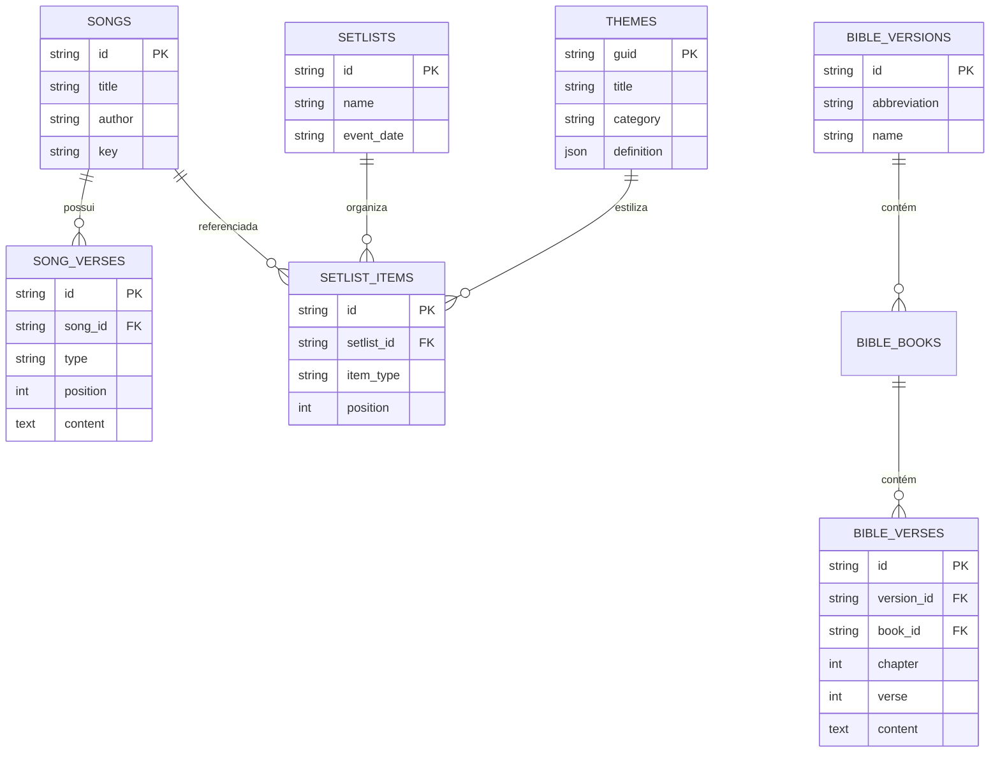

O Open Presenter utiliza **SQLite** integrado através do crate `rusqlite` no backend Rust, garantindo transações ACID, portabilidade e backups fáceis.

O arquivo do banco de dados fica localizado no diretório de dados do usuário:
- **macOS:** `~/Library/Application Support/com.openpresenter.app/open_presenter.db`
- **Windows:** `%APPDATA%\com.openpresenter.app\open_presenter.db`
- **Linux:** `~/.local/share/com.openpresenter.app/open_presenter.db`

---

## Tabelas Principais

1. **`songs` & `song_verses`:**
   - Armazena as músicas, títulos, autores, tom musical, tags e todas as estrofes com suas respectivas ordens e tipos (`verse`, `chorus`, `bridge`, etc.).
2. **`setlists` & `setlist_items`:**
   - Ordens de culto preparadas, datas de agendamento e itens encadeados (músicas, versículos bíblicos ou mídias).
3. **`bible_versions`, `bible_books`, `bible_verses`:**
   - Textos das traduções bíblicas instaladas no app com índices rápidos para buscas full-text.
4. **`themes`:**
   - Definições de temas visuais (v1 e v2) com CSS serializado, layers de texto e metadados.
5. **`settings`:**
   - Configurações do operador (chave/valor) para portas do servidor, tokens de acesso remoto, monitor padrão, etc.

---

## Sistema de Migrações Automáticas

As migrações do banco residem em `src-tauri/src/services/database.rs`:
- Toda vez que a aplicação é iniciada, o método `migrate(&conn)` é chamado.
- Cada migração é executada dentro de uma transação protegida. Se uma falhar, ocorre rollback seguro sem corromper os dados existentes do usuário.
