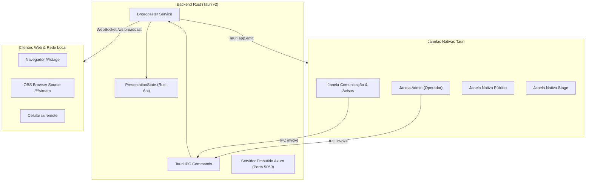

# Arquitetura do Open Presenter

Esta seção é o mapa técnico definitivo para **engenheiros de software**, **mantenedores** e **agentes autônomos de IA** que colaboram com a evolução do código do Open Presenter.

---

## 🏛️ Filosofia Arquitetural

O Open Presenter adota princípios rígidos de **SOLID**, **Clean Architecture** e **Feature-Driven Development**:

1. **Separação Rígida entre Backend e Frontend:**
   - O backend em Rust gerencia estados concorrentes, janelas nativas, servidor HTTP/WebSocket e o banco SQLite.
   - O frontend em React 19 é puramente reativo: consome eventos, renderiza interfaces com Tailwind CSS v4 e despacha comandos via IPC tipado.
2. **Shared Kernel (`src/core/`):**
   - Módulos transversais residem em `src/core/` (sincronização, tipos compartilhados, wrappers IPC, utilitários).
   - Tipos compartilhados entre Rust e TypeScript vivem em sincronia estrita entre `src/core/types/` e `src-tauri/src/state/types.rs`.
3. **Módulos Verticais Isolados (`src/features/*`):**
   - Cada funcionalidade vive em sua própria pasta (`bible`, `presentation`, `slide-themes`, `communication`, etc.).
   - Cada feature possui sua store Zustand (`store.ts`), seus componentes e seus helpers internos.
   - Comunicação entre features **nunca** é feita por imports cruzados profundos; usa o barramento `syncBus` ou stores expostas.
4. **Composição por Rota (`src/views/*`):**
   - As views (`AdminView`, `PublicView`, `StageView`, `StreamView`, `RemoteView`, `CommunicationView`) apenas compõem as features para as rotas correspondentes.

---

## 🔄 Fluxo de Dados: Single Source of Truth

- A **única fonte da verdade** para o slide ao vivo, temas, avisos e cronômetro é o **`PresentationState` em Rust**.
- Quando o operador altera um slide, o comando IPC dispara `Broadcaster`, que atualiza a memória e emite eventos para todas as janelas desktop (via eventos Tauri nativos) e clientes web (via WebSocket em `/ws`).
- Todas as telas reagem e sincronizam no mesmo frame de 60 FPS.
