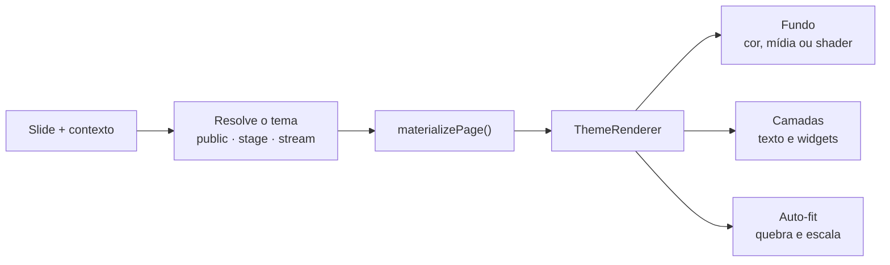

O motor de temas do Open Presenter é responsável por transformar dados brutos de slides em layouts visualmente impactantes, respeitando resolução, quebra de linha e responsividade.



---

## Estrutura de um Tema v2

Um tema v2 (`SlideTheme`) contém:
- `guid`: Identificador único UUID.
- `title`: Nome do tema (ex.: *Louvor Minimalista Escuro*).
- `category`: `public`, `stage` ou `stream`.
- `pages`: Lista de variações por contexto (`music`, `scripture`, `text`, `rest`).
- `elements`: Elementos visuais (caixas de texto, badges, relógios, imagens, variáveis dinâmicas).
- `css`: Estilos de fundo, gradientes, sombras e opacidade.

---

## Materialização por Contexto

O processo de materialização é puramente funcional e imutável (`src/features/slide-themes/pages.ts`):

```typescript
export function materializePage(theme: SlideTheme, page: ThemePage): SlideTheme {
  return {
    ...theme,
    elements: page.elements,
    css: {
      ...theme.css,
      background: page.background ?? theme.css.background,
    },
  };
}
```

Quando um slide é apresentado, o componente `SlideTransition` recebe o contexto atual (ex.: `scripture`) e seleciona a página adequada em tempo real via `getPageForContext`.

---

## Algoritmo de Auto-Shrink / Auto-Fit

Para garantir que textos longos nunca transbordem da tela ou fiquem cortados:
- O Open Presenter calcula a razão entre o tamanho do contêiner e o volume de texto.
- Se o texto ultrapassar a altura máxima permitida, o motor reduz dinamicamente o `font-size` em passos proporcionais até que o conteúdo caiba com espaçamento respirável.
- Caso o texto seja curto, o tamanho máximo configurado no tema é preservado para legibilidade à distância.

---

## Shaders ISF (Interactive Shader Format)

Para fundos dinâmicos em movimento sem arquivos de vídeo pesados:
- Utiliza **WebGL** através do engine em `src/features/media-shaders/isfEngine.ts`.
- Os shaders executam inteiramente na GPU, consumindo quase zero memória RAM e poupando CPU.
