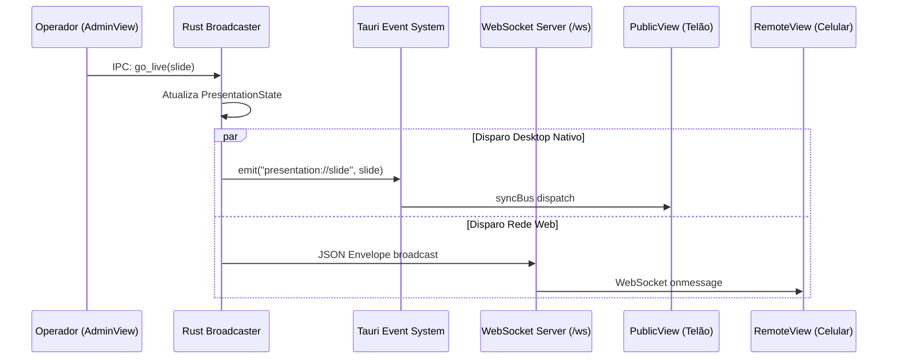

O Open Presenter opera em um modelo multi-tela altamente distribuído:
- Janela do Operador (`AdminView`).
- Janela de Comunicação (`CommunicationView`).
- Janela Física do Telão (`PublicView`).
- Janela Física do Retorno (`StageView`).
- Browser Source do OBS (`StreamView`).
- Navegadores móveis (`RemoteView`).

Para manter todas as saídas 100% sincronizadas sem discrepância de frames, o sistema utiliza o **`syncBus`** (`src/core/sync/syncBus.ts`).

---

## Como o `syncBus` Opera



---

## Inicialização do `syncBus`

No ambiente desktop (`isTauri()`), o `syncBus` registra listeners nativos do Tauri:

```typescript
if (isTauri()) {
  await listenCommand(TAURI_EVENTS.slide, (p) => dispatch(TAURI_EVENTS.slide, p));
  await listenCommand(TAURI_EVENTS.stageMessage, (p) => dispatch(TAURI_EVENTS.stageMessage, p));
  await listenCommand(TAURI_EVENTS.timer, (p) => dispatch(TAURI_EVENTS.timer, p));
  await listenCommand(TAURI_EVENTS.themes, (p) => dispatch(TAURI_EVENTS.themes, p));
  await listenCommand(TAURI_EVENTS.wallpaper, (p) => dispatch(TAURI_EVENTS.wallpaper, p));
}
```

No ambiente web externo (fora do Tauri):
- Conecta-se automaticamente via WebSocket: `ws://HOST:5050/ws`.
- Envia o handshake `client://hello` com o tipo de saída correspondente (`public`, `stage`, `stream`, etc.).
- Deserializa as mensagens e despacha para os mesmos callbacks locais.

> **REGRA ESSENCIAL:**
> Qualquer nova janela independente (como `CommunicationView` ou `PreferencesView`) ou novo hook de sincronização **deve** chamar `void syncBus.init()` ao montar, garantindo que os listeners nativos estejam ativos no contexto daquela janela específica.
