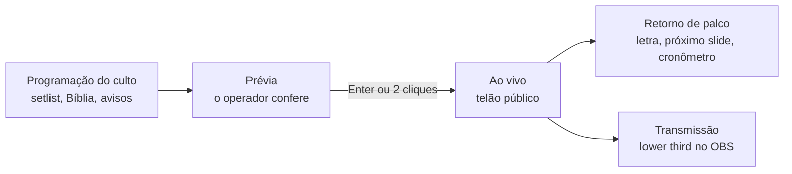

O **Open Presenter** é uma plataforma moderna, aberta e de alta performance para projeção de letras, escrituras bíblicas, mídias e comunicação em igrejas e eventos audiovisuais.

Arquitetura híbrida de alto desempenho: **Tauri v2 (Rust)** no backend e **React 19 + TypeScript + Tailwind CSS** no frontend. A velocidade e o baixo consumo de memória do desktop, com a flexibilidade da web moderna.

<Screenshot
  src="/screenshots/main.webp"
  alt="Painel do Open Presenter com setlist, letras, prévia, ao vivo e retorno de palco"
  caption="O painel do operador: programação, letras, prévia e as três saídas no mesmo lugar."
/>

## Por que Open Presenter?

Softwares tradicionais de projeção costumam cobrar caro por máquina, consumir memória demais e dificultar o controle remoto. O Open Presenter foi projetado para resolver esses problemas desde o primeiro dia:

- **Ultraleve e seguro.** O backend em Rust gerencia as saídas com latência mínima e quase zero overhead de CPU.
- **Multi-monitor de verdade.** Público, retorno de palco (stage) e transmissão (OBS/vMix) ao mesmo tempo.
- **Servidor web embutido.** Qualquer saída abre em navegadores da rede local na porta `5050`, sem placa de vídeo extra.
- **Controle remoto sem instalação.** O celular controla slides, Bíblia e cronômetro direto pelo navegador, via QR Code.
- **Comunicação integrada.** Avisos, mensagens e letreiros chegam às saídas sem interromper o culto.
- **Aberto de verdade.** Código-fonte público, licença MIT e releases assinadas.

## Como navegar

<Cards>
  <Card
    title="Guia do operador"
    description="Aprenda a operar cultos, montar setlists, projetar versículos, gerenciar monitores e usar atalhos."
    href="/docs/operacao"
  />
  <Card
    title="Desenvolvimento & IA"
    description="Arquitetura, IPC no Rust, syncBus, stores Zustand, banco SQLite e as regras do AGENTS.md."
    href="/docs/desenvolvimento"
  />
  <Card
    title="Arquitetura de sincronização"
    description="Como o PresentationState, o broadcaster e o WebSocket mantêm todas as telas no mesmo frame."
    href="/docs/desenvolvimento/sincronizacao-syncbus"
  />
  <Card
    title="API e automações"
    description="REST, Swagger, token de acesso, Stream Deck, Bitfocus Companion e integrações via WebSocket."
    href="/docs/desenvolvimento/api-e-automacoes"
  />
</Cards>

## Como iniciar localmente

Para rodar o aplicativo:

```bash
# 1. Instalar dependências
npm install

# 2. Rodar a interface web no navegador (Vite)
npm run dev

# 3. Rodar o aplicativo desktop completo (Tauri + Rust)
npm run tauri:dev
```

Para rodar esta documentação:

```bash
npm run docs:dev
```

A documentação fica em `http://localhost:3000`. O app compilado é servido pelo
servidor embutido na porta `5050`.

## O fluxo de uma apresentação



A regra é simples: **nada vai ao ar sem passar pela prévia**. Quando o momento chega, um comando só atualiza todas as saídas.
