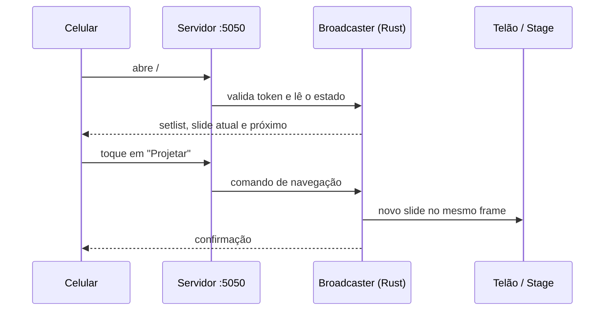

O Open Presenter inclui um servidor web integrado que permite a qualquer pessoa autorizada controlar a projeção usando o navegador de qualquer smartphone (iPhone, Android) ou tablet.

Não é necessário baixar nada na App Store ou Google Play!

---

## Como Conectar

1. Verifique se o smartphone está conectado na **mesma rede Wi-Fi** do computador que roda o Open Presenter.
2. Na janela do Open Presenter, abra as **Preferências ➔ Controle Remoto** (ou clique no ícone de smartphone).
3. Aponte a câmera do celular para o **QR Code** exibido na tela.
4. O link abrirá uma página web rápida (`http://IP_DO_COMPUTADOR:5050/#/remote`).

---

## Segurança e Token de Acesso

Para evitar que pessoas não autorizadas interfiram no culto:
- As conexões remotas exigem um **Token de Acesso (PIN)**.
- O token é gerado automaticamente e já vem embutido no QR Code.
- O operador pode revogar o token a qualquer momento nas configurações, desconectando todos os celulares instantaneamente.

---

## Funcionalidades do Controle Remoto

No celular, o líder de louvor ou pregador tem acesso a:

1. **Avançar e Voltar Slides:** Botões grandes e responsivos para avançar com o polegar.
2. **Visualização do Slide Ativo e Próximo:** Leitura confortável do texto do slide atual e do que vem a seguir.
3. **Lista de Músicas do Setlist:** Troca de músicas com 1 toque.
4. **Bíblia Rápida:** O pregador pode selecionar passagens bíblicas diretamente do celular para projetar.
5. **Cronômetro:** Visualização em tempo real do tempo restante de sermão.
6. **Blackout de Emergência:** Botão de tela preta caso precise suspender a projeção.
