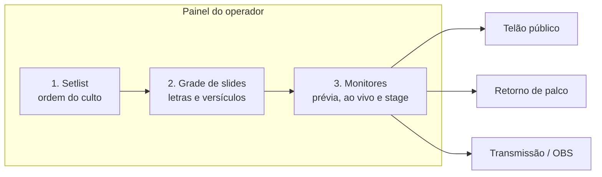

Este guia é voltado para os voluntários, técnicos de som, operadores de mídia e líderes de louvor que usam o **Open Presenter** durante os cultos e eventos.

---

## A Janela Principal (Painel do Operador)

Ao abrir o Open Presenter, você verá a janela de controle do operador dividida em três áreas principais:

<Screenshot
  src="/screenshots/main.webp"
  alt="Painel do operador com setlist à esquerda, grade de slides ao centro e monitores à direita"
  caption="Setlist, slides e monitores: a janela principal do operador."
/>

1. **Barra Lateral Esquerda (Setlist / Ordem do Culto):**
   - Lista sequencial das músicas, passagens bíblicas e momentos da reunião.
   - Permite arrastar para reordenar, adicionar itens pelo menu `Novo` ou importar músicas.
2. **Coluna Central (Grade de Slides):**
   - Exibe todos os blocos de texto ou mídias da música/leitura selecionada.
   - Suporta modos de visualização em **Cards** ou **Tabela**, com controle de zoom (mais ou menos colunas).
   - Cores intuitivas por tipo de estrofe: Verso, Refrão, Ponte, etc.
3. **Painel Direito (Monitores de Prévia & Controle):**
   - **Preview (Prévia):** Mostra o slide que você clicou para inspecionar, antes de mandar para o público.
   - **Ao Vivo (Telão):** Mostra exatamente o que a congregação está vendo neste exato milissegundo.
   - **Stage (Retorno):** Mostra a visão do monitor do púlpito/músicos (relógio, cronômetro, próximo slide).

---

## Regra de Ouro da Apresentação

O Open Presenter utiliza o clássico e seguro fluxo **Prévia ➔ Ao Vivo**:

| Ação | Como Fazer | Efeito |
| :--- | :--- | :--- |
| **Visualizar Prévia** | **1 clique** no slide | Carrega o slide no monitor de **Preview** (à direita) sem alterar o telão da congregação. |
| **Projetar Ao Vivo** | **2 cliques** ou teclar **`Enter`** | Projeta o slide imediatamente no Telão Público e no Retorno com transição suave. |
| **Navegar Rápido** | Tecla **`Espaço`** ou **`→`** | Avança para o próximo slide diretamente no ar. |
| **Voltar Slide** | **`Shift + Espaço`** ou **`←`** | Retorna ao slide anterior. |

---

## Controles de Emergência (Blackout & Clear)

Em qualquer momento do culto, se algo inesperado acontecer (ex.: o pregador mudar de assunto ou o pastor pedir para tirar a letra), utilize os controles rápidos:

### 1. Blackout (`B`)
- **Tecla:** `B` ou botão **Blackout** no topo.
- **Efeito:** Escurece instantaneamente o telão público com um fade suave para preto total.
- **Dica:** O slide que estava sendo exibido continua pausado. Pressionar `B` novamente retoma a projeção no mesmo ponto.

### 2. Limpar Texto (`C`)
- **Tecla:** `C` ou botão **Limpar Texto**.
- **Efeito:** Oculta a letra ou versículo, mas **mantém o plano de fundo (ou vídeo animado)** no telão. Muito útil durante ministrações espontâneas.

### 3. Fundo Ativo (`F`)
- **Tecla:** `F` ou botão **Apresentar Fundo**.
- **Efeito:** Projeta apenas o plano de fundo do tema ou o papel de parede configurado, ideal para momentos de transição entre músicas.
