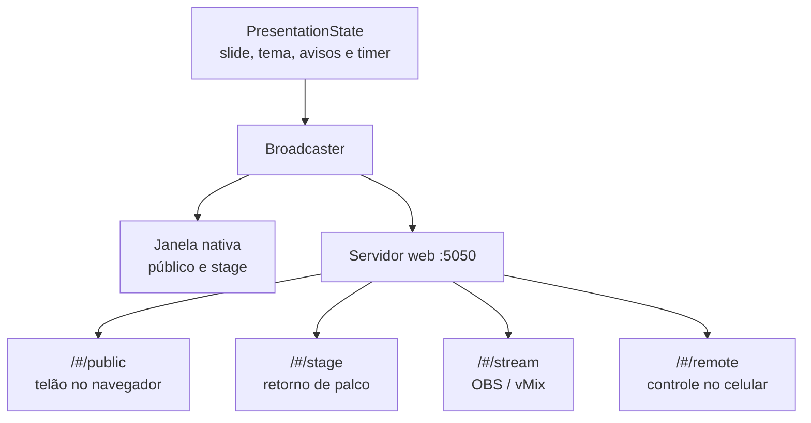

O Open Presenter gerencia até 3 destinos principais de exibição simultânea:

1. **Público (Telão / Projetor):** A saída principal voltada para a igreja/congregação.
2. **Stage (Retorno de Palco):** Monitor voltado para o pastor, pregador e grupo de louvor.
3. **Stream (Transmissão ao Vivo):** Saída transparente com Lower Thirds para OBS Studio, vMix ou encoders NDI.



---

## Modos de Saída

Para cada saída, você pode escolher como deseja projetar:

| Modo | Como Funciona | Ideal para |
| :--- | :--- | :--- |
| **Nativo (Desktop)** | Abre uma janela física de tela cheia sem bordas no monitor conectado via HDMI/DisplayPort. | Computadores com múltiplas saídas de vídeo dedicadas. |
| **Web (Rede Local)** | Disponibiliza a saída via navegador web em `http://IP_DO_PC:5050/#/public` ou `/#/stage`. | Usar Smart TVs, tablets, notebooks secundários ou Raspberry Pi sem cabos longos de vídeo. |
| **Nativo + Web (Ambos)** | Projeta na saída física e simultaneamente transmite via rede local. | O melhor dos dois mundos. |

---

## Configurando as Saídas no App

1. Abra as **Preferências** (`⌘ ,` ou menu `Open Presenter ➔ Preferências`).
2. Clique na aba **Saídas**:
   - O sistema detecta automaticamente todos os monitores conectados (Resolução, taxa de atualização e nome).
   - Atribua qual monitor é o **Público** e qual é o **Stage**.
   - Defina se a janela deve abrir automaticamente ao iniciar o aplicativo.
3. Se você desconectar ou conectar um cabo HDMI com o app aberto, clique em **Identificar Monitores** para atualizar o mapeamento sem reiniciar.

---

## Integração com OBS Studio e vMix (Live Stream)

Para projetar letras e versículos na sua transmissão do YouTube/Facebook:

1. No OBS Studio, adicione uma nova fonte do tipo **Navegador (Browser Source)**.
2. Na URL, coloque:
   ```text
   http://localhost:5050/#/stream
   ```
3. Defina a resolução como `1920x1080` (ou a mesma da sua transmissão).
4. Marque a opção de **atualizar o navegador quando a cena ficar ativa**.
5. **Pronto!** O fundo da saída `stream` é 100% transparente. As letras aparecerão em formato *Lower Third* (terço inferior da tela) sobre a imagem da câmera, com tipografia legível e sombra suave.
